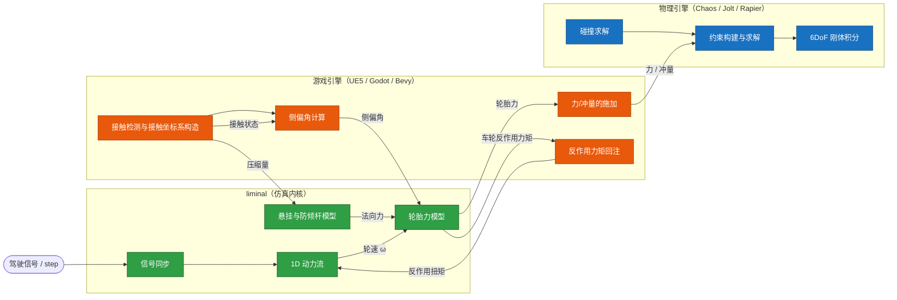

# liminal

多域端口图（**Multi-Domain Port Graph**）载具仿真库：以类型化端口图描述载具结构，求解一维动力流与力模型，空间刚体动力学交由物理引擎承担。

库以 Rust 编写，为跨引擎（UE5 / Godot / Bevy）的载具物理游戏提供可移植的仿真内核，设计取向有两条参照：

- 求解语义参照 Jolt Vehicles：轮胎与传动趋向冲量（**Impulse**）与约束（**Constraint**）语义，而不是把轮胎当作外力近似；
- 职责边界参照 Chaos Vehicles：库不拥有刚体，空间域只产出关节与位姿描述，由宿主构建原生约束并积分。

各条载具仿真路线的机制与取舍对比，见[载具物理仿真路线研究报告](docs/vehicle-physics-routes.md)。

宿主通过 C ABI 接入，须遵守[适配契约](docs/adapter-contract.md)。

## 特性

- 涌现式组合（**Emergent Composition**）：载具行为由单元的连接方式涌现，而非由代码分支枚举——抽掉悬挂即得刚性连接，拔掉转向节即失去转向，发动机直连车轮即可驱动
- 面向物理域（**Physical Domain**）编程：单元只声明端口能力（域、方向、容量），不感知其它单元的具体类型；连接合法性在编辑期校验；动力流按键合图（**Bond Graph**）思想双向耦合，车轮卡死的零转速会逆向传回发动机
- 图编译（**Graph Compilation**）：拓扑是编辑态数据（**Authoring Data**），步进前编译为运行态执行数据（**Runtime Data**）——旋转域连通岛独立求解、空间域运动学树（含挂载位姿推导）、信号域拓扑序指令表；拓扑不变时无图遍历开销
- 动态拓扑：世代索引（**Generational Index**）支持运行时增删单元与改接连线，端口载荷跨重编译保留，热插拔（**Hot-swap**）后运行状态不重置
- 最小依赖：仅 slotmap 与 smallvec

## 物理

同一条「底盘 → 悬挂 → 转向节 → 车轮」链路混杂着机械动力流与空间运动学两类关系；域分离让两类关系各走独立的通道，是组合涌现的前提。四个域各自独立求解：

- Rotational1D —— 一维旋转机械，承载扭矩（**Torque**）与角速度（**Angular Velocity**）
  - 固定传动比把端口并合为转速连通组（**Body**），组内折算到参考轴：`J_eq = ΣJ·r²`、`ω_port = r·ω_body`
  - 单元可声明速度级约束：开式差速强制 `ω_in = mean(ω_out)` 并等扭矩分配；库仑摩擦在扭矩上限内锁止相对转速（制动器、离合器、车轮摩擦）
  - 约束以顺序冲量（**Sequential Impulses / PGS**）迭代求解，库仑摩擦的冲量上限为 `max_torque·dt`；驱动与外部注入扭矩按冲量施加，单步消费后清零
  - 发动机：全油门扭矩曲线（归一化转速线性插值）、怠速比例控制、发动机制动（速度比例的库仑摩擦约束）
- Spatial6DoF —— 空间挂接；库产出关节描述符（Rigid / Revolute / PrismaticSpring，含行程限制）与静止位姿（**Rest Pose**），约束的构建与求解在物理引擎侧
- SignalScalar —— 控制信号；编译为按拓扑序排列的扁平拷贝指令表，逐帧同步，存在有向环时编译失败
- FluidFuel —— 燃料与能量管路；端口与载荷已定义，单元尚未实现

轮胎与悬挂模型为纯函数，由宿主在接触解中求值：

- 轮胎载荷敏感：摩擦圆上限按 `μ₀·(F_N/F_ref)^(-k)` 随载荷衰减，参考载荷处为峰值
- 轮胎模型：纵向按“本步内对齐轮面与地面速度”的冲量折算（等效刚度 `J/R²`），侧向按侧偏刚度（**Cornering Stiffness**），合力按摩擦圆裁剪；滚动阻力逆向地面速度，不产生车轮反作用力矩
- 悬挂：由压缩量与压缩速度计算法向力，只推不拉
- 防倾杆：两侧悬挂压缩差经扭转刚度产生等量反向的附加法向力

内置单元：驾驶舱、信号分发器、发动机（扭矩曲线/怠速/发动机制动）、轮轴、差速器（**Differential**，开式差速 + 摩擦限滑）、车轮、变速箱、离合器、制动器、底盘、悬挂、转向节。

## 拓扑

载具被建模为一张多域有向端口图。动力流是网状的：双引擎可以并联进一个分动箱再输出到四轮，地面的反作用会逆向传回发动机——这种多对多汇流与双向因果无法用树状层级表达，因此用图。

图的组成：

- 节点：单元的实例，持有状态与行为的黑盒；删除后世代索引自动失效，不产生悬垂引用
- 端口：节点暴露的接口，携带物理域、方向与容量约束，决定什么能连接
- 边：两个兼容端口之间的域内连接；数据上有向，物理上双向耦合

图是编辑态数据：拼装、改装与战损断裂都只是图操作；结构变更置脏，下次步进触发重编译，把图拍平为运行态执行数据，热路径上没有图遍历。编译产出三份：

1. 信号指令表 —— 信号域按单元拓扑排序（**Topological Sort**）展开的扁平拷贝序列，逐帧同步
2. 动力岛（**Drivetrain Island**）—— 旋转域连通分量（**Connected Components**），每个岛划分为转速连通组并以速度级约束独立求解
3. 空间运动学树（**Kinematic Tree**）—— 自底盘根展开，每条连接携带关节描述符、控制端口与静止位姿（相对父与相对底盘）；游戏引擎据此构建原生约束，抽掉悬挂或转向节时硬连接与无转向自然涌现

约定：

- 挂载位姿（**Mount Frame**）：空间端口可声明节点本地系的安装位姿；一条连接在静止位形下令两端重合，即 `T_childInParent = T_parentMount ∘ T_childMount⁻¹`
- 载具坐标系：X = 右（滚动轴）、Y = 上（悬挂与转向轴）、Z = 前；关节量定义在子节点本地系
- 单位：内部一律 SI；四元数顺序 (x, y, z, w)

## 边界

游戏引擎对上消费 liminal，对下驱动物理引擎：

| 能力                                  | liminal | 游戏引擎 | 物理引擎 |
| ------------------------------------- | :-----: | :------: | :------: |
| 拓扑编排与校验                        |   ✅    |    —     |    —     |
| 信号同步                              |   ✅    |    —     |    —     |
| 1D 动力流                             |   ✅    |    —     |    —     |
| 静止位姿链                            |   ✅    |    —     |    —     |
| 轮胎力模型                            |   ✅    |    —     |    —     |
| 悬挂法向力与防倾杆模型                |   ✅    |    —     |    —     |
| 空间/关节约束构建与求解               |    —    |    —     |    ✅    |
| 6DoF 刚体积分                         |    —    |    —     |    ✅    |
| 碰撞求解                              |    —    |    —     |    ✅    |
| 接触检测（射线/扫掠）与接触坐标系构造 |    —    |    ✅    |    —     |
| 侧偏角计算（依赖速度场）              |    —    |    ✅    |    —     |
| 力/冲量的施加                         |    —    |    ✅    |    —     |
| 轮胎反作用力矩回注 1D 域              |    —    |    ✅    |    —     |

每帧的闭环数据流：



库输出轮胎冲量解、悬挂与防倾杆力模型；施加时机与载体由适配层按宿主能力决定。

完整契约（坐标系与单位换算、每帧行为序列、端口索引表与已知限制）见 [docs/adapter-contract.md](docs/adapter-contract.md)。

## 后端

库只提供共同内核：拓扑编排、信号同步、一维动力流、轮胎、悬挂与防倾杆模型、静止位姿。刚体、接触与约束求解由宿主承担；耦合形态不写死在库里，由适配层按宿主能力选择。

- **外力**：轮胎、悬挂与防倾杆力作为外力施加，轮速与车身速度显式交替。适配层承担接触、滑移、施加与回注，并以子步化、静止钳制与阻尼泄压保证数值稳定。可移植性最高，数值条件最弱。
- **约束**：轮胎模型输出本步目标与冲量界，悬挂输出约束参数，轮速与车身速度在求解器内隐式联立。稳定性由求解器吸收，数值条件最好，前提是宿主开放求解器参与。
- **物理车轮**：车轮为刚体，悬挂为关节，轮胎力来自通用接触摩擦。库的轮速所有权与轮胎模型在此让位于引擎，作用面收缩为信号、动力流与两者的拓扑编排；动力流亦可消解进关节。
- **物质**：结构、轮胎与悬挂的行为由质点-弹簧系统涌现，库只保留信号与一维动力流；宿主为专用软体世界，跨引擎可移植性不再成立。

耦合越深，物理正确性与涌现上限越高，对宿主的介入要求越高，可移植性越低。当前实现采用冲量语义；耦合所需的约束构建与求解由宿主承担；物理车轮与物质后端会压缩库的作用面，是否采用取决于产品目标。

## 构建

```sh
cargo test              # 单元测试
cargo build --release   # 产出 staticlib，供宿主链接
cargo run               # 四轮动力链演示
```

宿主接入前须先完成 release 构建，并链接 `target/release` 下的静态库；接入步骤与头文件约定见[适配契约](docs/adapter-contract.md)。

## 状态与已知限制

- 早期阶段，API 尚未稳定；单元测试覆盖拓扑、编译、求解、轮胎与悬挂模型及 C ABI
- 差速器为开式差速约束 + 摩擦限滑；限滑为输出端之间的库仑摩擦约束，扭矩容量为 `max_torque`
- 发动机：默认参数为线性衰减且关闭怠速/发动机制动；曲线、怠速与制动需显式配置
- 轮胎模型为摩擦圆限制下的纵向冲量解与侧向刚度模型，含载荷敏感与滚动阻力；无瞬态松弛长度与胎体柔性
- 空间域存在环时静默取树，未像信号域那样报错
- 无气动；未考虑网络同步与回放
